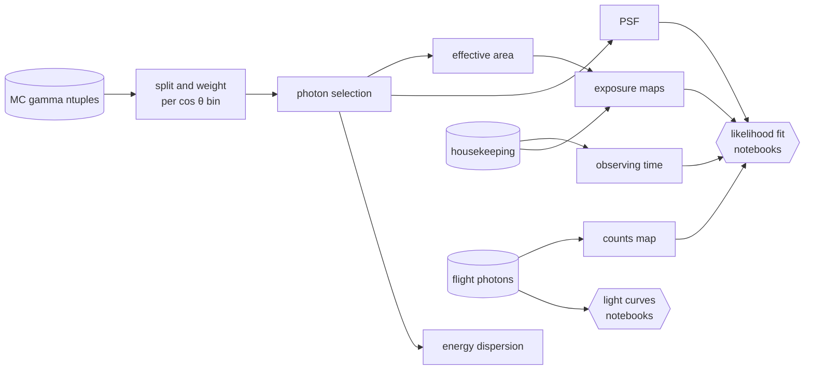

# DAMPE gamma ray pipeline

Instrument response, exposure and pulsar timing analysis for the DArk Matter Particle
Explorer (DAMPE) space telescope, developed during a master's thesis
at the University of Geneva (DPNC).

<p align="center">
  
  <br>
  <em>The Vela pulsar seen by DAMPE: nine years of photons folded on its rotation phase.</em>
</p>

The package turns simulated and flight data into the ingredients of a gamma ray source
analysis:

* **Photon selection** of the Monte Carlo sample, reweighted to a flat spectrum.
* **Instrument response functions**: effective area, point spread function (double King
  fit) and energy dispersion, tabulated in energy and incidence angle.
* **Observing time and exposure maps** computed from the satellite housekeeping data, with
  the South Atlantic Anomaly removed.
* **Counts maps**, which together with the above feed a template likelihood fit and the
  pulsar light curves (notebooks).

## Pipeline



| Stage | Command | Slurm launcher |
|---|---|---|
| Split the MC into 20 cos(θ) bins and add spectral weights | `split` | `slurm/01_split_and_weight.sh` (array of 20) |
| Apply the photon selection | `filter` | `slurm/02_filter.sh` (array of 20) |
| Spectrum after each cut | `cutflow` | `slurm/03_cutflow.sh` |
| Effective area | `effective-area` | `slurm/04_effective_area.sh` |
| Point spread function | `psf` | `slurm/05_psf.sh` |
| Energy dispersion | `energy-dispersion` | `slurm/06_energy_dispersion.sh` |
| Observing time of a sky position | `observing-time` | `slurm/07_observing_time.sh` |
| Daily exposure maps, all sky or around a target | `exposure-map` | `slurm/08_exposure_daily.sh`, `slurm/09_exposure_target.sh` |
| Sum daily maps | `sum-exposure` | `slurm/10_sum_exposure.sh` |
| All sky counts map | `counts-map` | `slurm/11_counts_map.sh` |

Every command is run as `python -m dampe_gamma <command>`; `--help` lists its options.

## Results

<table>
  <tr>
    <td width="50%"></td>
    <td width="50%"></td>
  </tr>
  <tr>
    <td><em>Counts map of nine years of selected photons in galactic coordinates; the
    Galactic plane and bright sources such as Vela stand out.</em></td>
    <td><em>Exposure (cm² s) accumulated over the mission, shaped by the orbit and the
    pointing strategy.</em></td>
  </tr>
  <tr>
    <td></td>
    <td></td>
  </tr>
  <tr>
    <td><em>Effective area versus energy and incidence angle, from the selection
    efficiency of the weighted MC.</em></td>
    <td><em>68% containment angle of the PSF per (energy, cos θ) bin.</em></td>
  </tr>
  <tr>
    <td></td>
    <td></td>
  </tr>
  <tr>
    <td><em>Scaled angular deviation in one bin, fitted with a King core and a King tail in
    two stages.</em></td>
    <td><em>Cumulative efficiency of each selection cut versus energy.</em></td>
  </tr>
  <tr>
    <td></td>
    <td></td>
  </tr>
  <tr>
    <td><em>Time Vela spent at each position of the field of view over nine years.</em></td>
    <td><em>Template likelihood fit around Vela: Galactic, isotropic and source components
    against the data.</em></td>
  </tr>
</table>

## Repository layout

```
src/dampe_gamma/
├── cli.py, config.py        command line entry point, configurable paths
├── binning.py, io.py, ...   shared binning, ROOT access, statistics, plotting
├── selection/               cuts, spectral weighting, split, filter, cutflow
├── irf/                     effective area, PSF models and fit, energy dispersion
├── exposure/                housekeeping, SAA, detector frame, observing time, exposure maps
├── flux/                    counts map
└── ephemeris.py             pulsar .par files
slurm/          one sbatch script per stage, sharing slurm/env.sh
notebooks/      analysis notebooks: irf/, exposure/, flux/, pulsars/, exploration/
macros/         ROOT macro for the per cut efficiency plots
tools/          data availability checks, Jupyter launcher
data/           pulsar ephemerides and the list of days with flight data
tests/          unit tests, runnable without ROOT or data
```

Design choices worth knowing:

* **ROOT stays at the edges.** Only file access imports PyROOT, lazily. All science code
  works on numpy arrays and pandas tables, so the test suite runs anywhere.
* **One implementation per concept.** Binning, cuts, the King models, the SAA mask, the
  satellite frame and the `.par` parser each live in a single module; variants of the
  original scripts became command line options.
* **No hardcoded paths.** Locations come from environment variables (below).

## Installation

On the Baobab cluster, ROOT and the scientific stack come from an LCG view:

```bash
git clone <this repository> && cd dampe_unige
source slurm/env.sh            # LCG view, PYTHONPATH and DAMPE_DATA_DIR
python -m dampe_gamma --help
```

Anywhere else (everything except the ROOT based steps):

```bash
pip install -e ".[dev]"        # add ".[notebooks]" for the likelihood notebooks
pytest
```

### Configuration

| Variable | Content | Default |
|---|---|---|
| `DAMPE_MC_DIR` | raw MC gamma ntuples | `/dpnc/beegfs/dampe/tryf/MC_Skimmed/MC_gamma_wo1GeVCut` |
| `DAMPE_HK_DIR` | flight data and housekeeping | `/dpnc/beegfs/dampe/prod/FM/skim/6.0.0/v2` |
| `DAMPE_WORK_DIR` | large intermediate products (per bin MC, daily maps) | `/dpnc/beegfs/dampe/tryf/ForKimberly` |
| `DAMPE_RESULTS_DIR` | IRF tables and summed maps | `~/results` |
| `DAMPE_FIGURES_DIR` | figures | `~/figures` |
| `DAMPE_DATA_DIR` | ephemerides, date list, flight photon ntuple | `data/` |

The flight data analysis expects `DmlNtup_Data_9years_FullPhotonData_AllSky.root` in
`DAMPE_DATA_DIR`.

## Running the pipeline

Slurm scripts are submitted from the repository root; logs go to `logs/`.

```bash
# Selection (already run: outputs live in DAMPE_WORK_DIR)
sbatch slurm/01_split_and_weight.sh 0     # 0: flat spectrum in log(E), used for IRFs
sbatch slurm/02_filter.sh 0

# Instrument response
sbatch slurm/04_effective_area.sh giem    # the exposure maps need the GIEM energy bins
sbatch slurm/05_psf.sh

# Exposure: list available days, then one job per day of a year
tools/find_available_dates.sh
sbatch slurm/08_exposure_daily.sh 2021 6  # year, energy bin index
sbatch slurm/10_sum_exposure.sh 6
```

The exposure maps follow the energy binning of the Fermi Galactic Interstellar Emission
Model (GIEM), extended by four bins above 1 TeV.

## Notebooks

The notebooks are the record of the analysis that produced the figures above; their outputs
are stripped to keep the repository light.

| Folder | Content |
|---|---|
| `irf/` | interactive versions of the effective area, PSF and energy dispersion studies |
| `exposure/` | summing observing time maps, target exposure |
| `flux/` | flux maps and the template likelihood fit (GIEM, isotropic, point source, PSF convolution, iminuit and emcee) |
| `pulsars/` | export of flight photons to CSV, light curves with PINT, energy spectra |
| `exploration/` | one off checks: selection, reconstruction, housekeeping, satellite orbit |

The light curves use a fork of PINT adapted to DAMPE,
[PINT_dampe](https://github.com/Lgtlebrun/PINT_dampe), installed in its own environment
(`tools/start_jupyter.sh <venv>` starts a server with it). They read the CSV export of the
flight data, so ROOT is not needed there.

## Limitations

The code reproduces the thesis results; it is not a validated DAMPE analysis.
[REPORT.md](REPORT.md) lists the suspected issues found while refactoring (kept on purpose
so that results stay reproducible), the behaviour changes, and the open problems of the
method. The original scripts are preserved on the `ll_bak` branch.

## Citation

```
@Article{particles9030077,
AUTHOR = {Lebrun, Léonard and Frieden, Jennifer Maria and Perrina, Chiara},
TITLE = {Timing Analysis of Bright Pulsars with Nine Years of DAMPE Data},
JOURNAL = {Particles},
VOLUME = {9},
YEAR = {2026},
NUMBER = {3},
ARTICLE-NUMBER = {77},
URL = {https://www.mdpi.com/2571-712X/9/3/77},
ISSN = {2571-712X},
DOI = {10.3390/particles9030077}
}

```

## Acknowledgements

* Paul Ray and Matthew Kerr, for the pulsar ephemerides in `data/par/` (private
  communication). Please acknowledge them if you use these files.
* Jennifer Frieden, for the photon selection algorithm implemented in
  `selection/cuts.py`.
* The DAMPE group at the University of Geneva.
