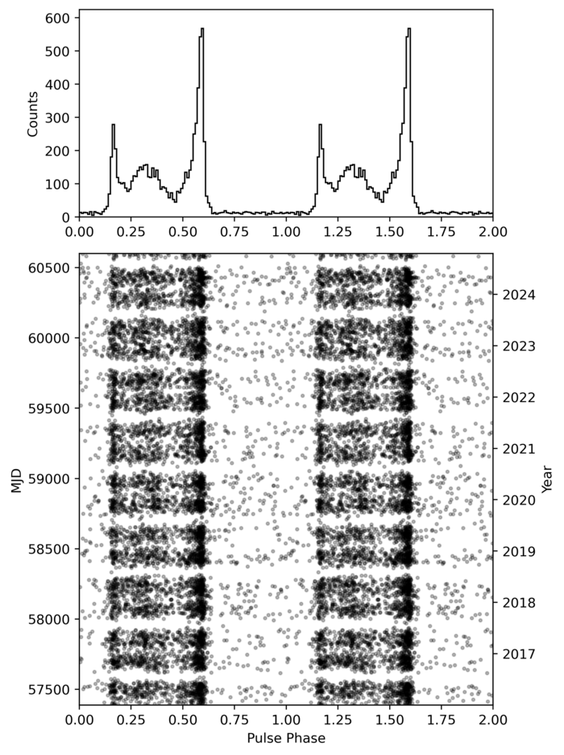
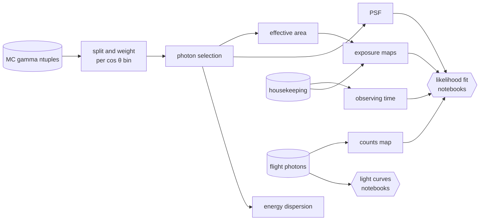

# DAMPE gamma ray pipeline

Instrument response, exposure and pulsar timing analysis for the DArk Matter Particle
Explorer (DAMPE) space telescope, developed during a master's thesis
at the University of Geneva (DPNC).

<p align="center">
  
  <br>
  <em>The Vela pulsar seen by DAMPE: nine years of photons folded on its rotation phase.</em>
</p>

The package turns simulated and flight data into the ingredients of a gamma ray source
analysis:

* **Photon selection** of the Monte Carlo sample, reweighted to a flat spectrum.
* **Instrument response functions**: effective area, point spread function (double King
  fit) and energy dispersion, tabulated in energy and incidence angle.
* **Observing time and exposure maps** computed from the satellite housekeeping data, with
  the South Atlantic Anomaly removed.
* **Counts maps**, which together with the above feed a template likelihood fit and the
  pulsar light curves (notebooks).

## Pipeline



Each stage is a command, `python -m dampe_gamma <command>` (`--help` lists the options),
with a matching Slurm launcher in `slurm/`.

## Repository layout

```
src/dampe_gamma/
├── cli.py, config.py        command line entry point, configurable paths
├── binning.py, io.py, ...   shared binning, ROOT access, statistics, plotting
├── selection/               cuts, spectral weighting, split, filter, cutflow
├── irf/                     effective area, PSF models and fit, energy dispersion
├── exposure/                housekeeping, SAA, detector frame, observing time, exposure maps
├── flux/                    counts map
└── ephemeris.py             pulsar .par files
slurm/          one sbatch script per stage, sharing slurm/env.sh
notebooks/      analysis notebooks: irf/, exposure/, flux/, pulsars/, exploration/
macros/         ROOT macro for the per cut efficiency plots
tools/          data availability checks, Jupyter launcher
data/           pulsar ephemerides and the list of days with flight data
tests/          unit tests, runnable without ROOT or data
```

ROOT is only imported where ROOT files are read; all science code works on numpy arrays
and pandas tables, so the tests run anywhere.

## Installation

On the Baobab cluster, ROOT and the scientific stack come from an LCG view:

```bash
source slurm/env.sh
python -m dampe_gamma --help
```

Anywhere else (everything except the ROOT based steps):

```bash
pip install -e ".[dev]"
pytest
```

Data locations are read from the environment variables `DAMPE_MC_DIR`, `DAMPE_HK_DIR`,
`DAMPE_WORK_DIR`, `DAMPE_RESULTS_DIR`, `DAMPE_FIGURES_DIR` and `DAMPE_DATA_DIR`. Defaults
point to the Baobab layout used for the thesis (see `src/dampe_gamma/config.py`).

## Running the pipeline

Slurm scripts are submitted from the repository root; logs go to `logs/`.

```bash
sbatch slurm/01_split_and_weight.sh 0     # 0: flat spectrum in log(E), used for IRFs
sbatch slurm/02_filter.sh 0
sbatch slurm/04_effective_area.sh giem    # exposure maps need the GIEM energy bins
sbatch slurm/05_psf.sh
tools/find_available_dates.sh
sbatch slurm/08_exposure_daily.sh 2021 6  # year, energy bin index
sbatch slurm/10_sum_exposure.sh 6
```

The light curve notebooks use [PINT_dampe](https://github.com/Lgtlebrun/PINT_dampe), a fork
of PINT, installed in its own environment (`tools/start_jupyter.sh <venv>`).

## Limitations

The code reproduces the thesis results; it is not a validated DAMPE analysis.
[REPORT.md](REPORT.md) lists the suspected issues found while refactoring, the behaviour
changes, and the open problems of the method.

## Citation

```bibtex
@Article{particles9030077,
AUTHOR = {Lebrun, Léonard and Frieden, Jennifer Maria and Perrina, Chiara},
TITLE = {Timing Analysis of Bright Pulsars with Nine Years of DAMPE Data},
JOURNAL = {Particles},
VOLUME = {9},
YEAR = {2026},
NUMBER = {3},
ARTICLE-NUMBER = {77},
URL = {https://www.mdpi.com/2571-712X/9/3/77},
ISSN = {2571-712X},
DOI = {10.3390/particles9030077}
}
```

## Acknowledgements

Paul Ray and Matthew Kerr provided the pulsar ephemerides in `data/par/` (private
communication); please acknowledge them if you use these files. The photon selection
follows Jennifer Frieden's algorithm.
